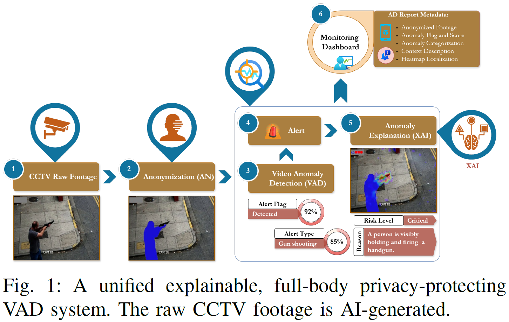
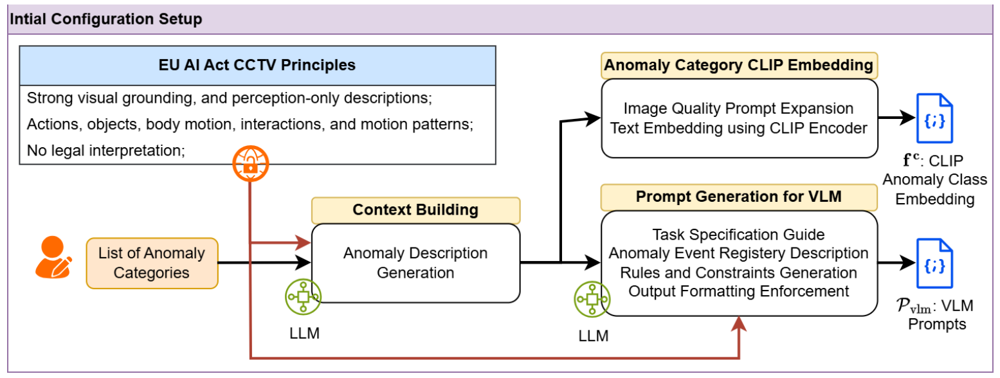
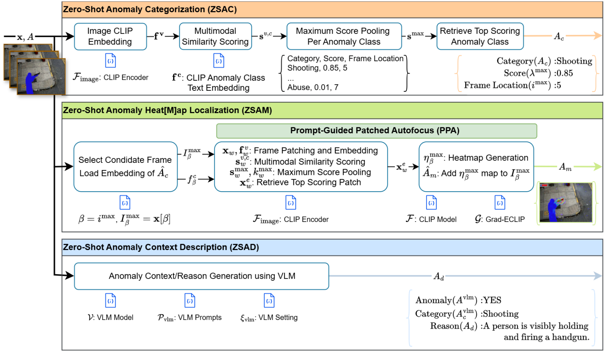
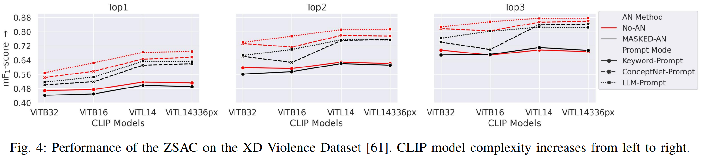
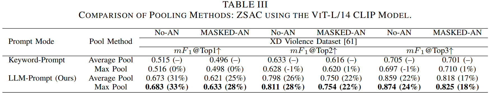
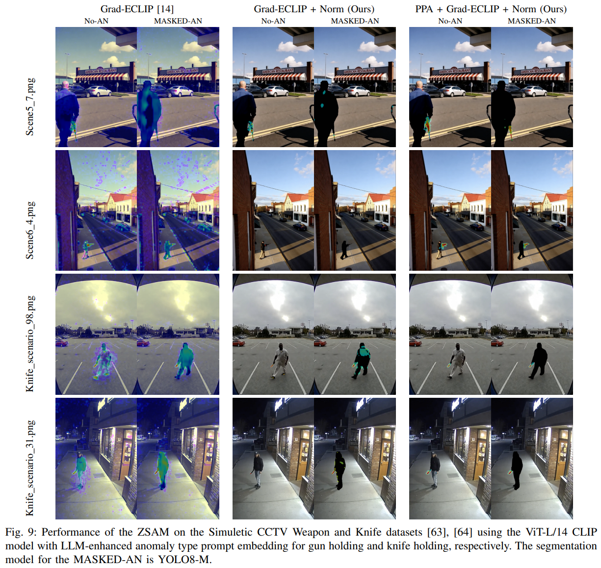
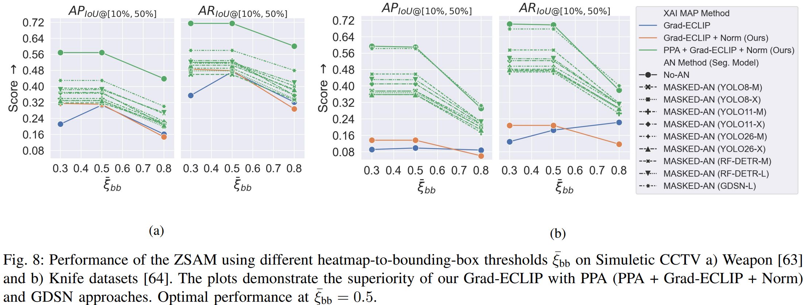
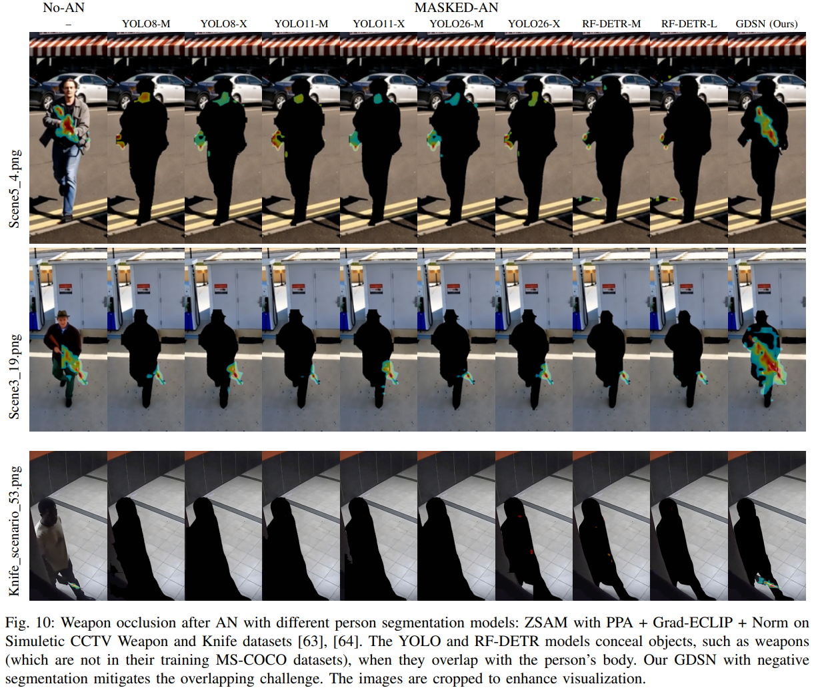
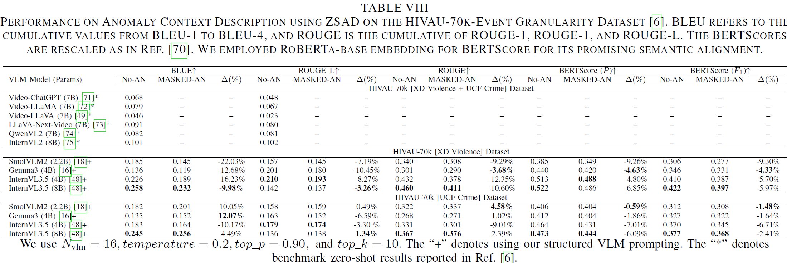
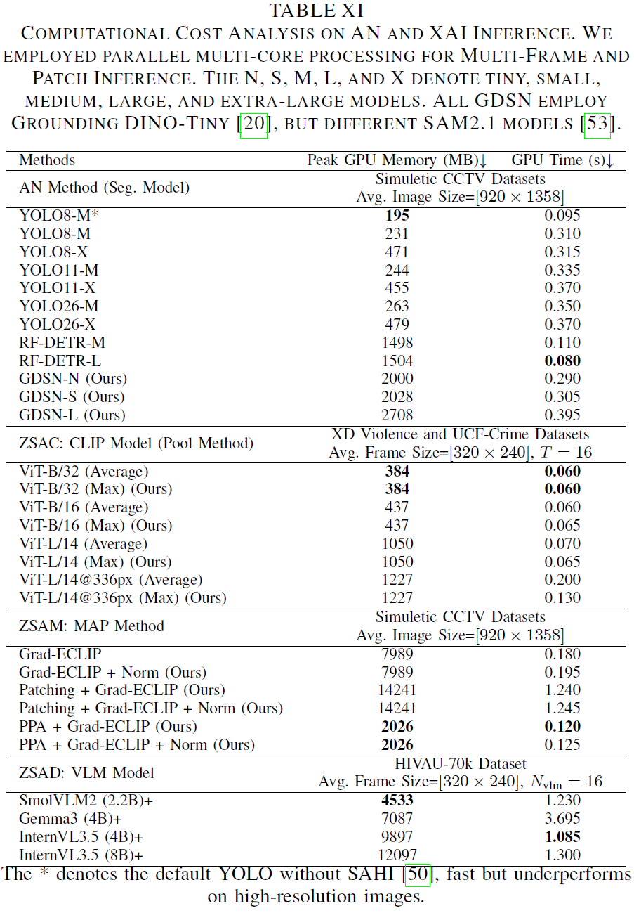

<div>
    <!-- <a href="https://github.com/muleina/XAVAD/actions/workflows/python-package-conda.yml"></a> -->
    <a href="https://ai4citizens.uia.no/app_dashboard"></a>
    <!-- <a href="https://arxiv.org/abs/"></a> -->
    <!-- <a href="https://github.com/muleina/XAVAD/blob/main/results/Supplementary_material.pdf"></a> -->
</div>

# XAVAD: Zero-Shot Anomaly XAI for Anonymized Video Anomaly Detection

Official implementation of "Guided Zero-Shot Anomaly Explanation for Anonymized Crowd Video Monitoring: Context, Categorization, and Spatial Localization"

The XAVAD offers zero-shot multi-facet anomaly XAI for anonymized (AN) video anomaly detection (VAD). 

## Highlights

- Explainable and privacy-protecting VAD will build transparency and trust, and facilitate the adoption of computer vision systems, including safety and security monitoring.  
- XAVAD presents a unified approach that integrates flexible zero-shot methods for anomaly type categorization, visual localization, and scene context description. 
- Adopts a multimodal CLIP embedding for videos, using improved LLM-assisted prompting and pool-scoring mechanisms across a sequence of video frames for alert-type identification. 
- Employs Grad-ECLIP to generate heatmaps for visual alert localization, leveraging computation and accuracy through a novel prompt-guided patching autofocus mechanism. 
- Integrates a VLM to generate anomaly descriptions through curated prompt engineering.  
- XAVAD demonstrates a substantial gain over SOTA approaches and provides insights into privacy protection (full-body visual anonymization) trade-offs in XAI for VAD. 

System highlight of unified explainable, full-body privacy-protecting VAD system.




## System Design of the XAVAD  

XAVAD System Pipeline Diagram: Initial Setup Stage



XAVAD System Pipeline Diagram: Inference Stage




<!-- START doctoc -->
**Table of Contents**
- [Resources](https://github.com/muleina/XAVAD#resources)
- [Installation](https://github.com/muleina/XAVAD#installation)
- [Notebooks](https://github.com/muleina/XAVAD#notebooks)
- [Results](https://github.com/muleina/XAVAD#results)
  - [Zero-Shot Anomaly Categorization](https://github.com/muleina/XAVAD#zero-shot-anomaly-categorization)
  - [Zero-Shot Anomaly Heatmap Localization](https://github.com/muleina/XAVAD#zero-shot-anomaly-heatmap-localization)
  - [Zero-Shot Anomaly Context Description](https://github.com/muleina/XAVAD#zero-shot-anomaly-context-description)
- [Computational Cost Analysis](https://github.com/muleina/XAVAD#computational-cost-analysis)
- [BibTeX Citation](https://github.com/muleina/XAVAD#bibtex-citation)

<!-- END doctoc generated TOC please keep comment here to allow auto update -->


## Resources

We thank and give credit to the public data sets and source codes for the models listed below.

- Data sets
    - Video Anomaly Detection:
        - UCF-Crime ([repo](https://www.crcv.ucf.edu/projects/real-world/), [paper](https://openaccess.thecvf.com/content_cvpr_2018/html/Sultani_Real-World_Anomaly_Detection_CVPR_2018_paper.html))
        - XD-Violence ([repo](https://roc-ng.github.io/XD-Violence/), [paper](https://link.springer.com/chapter/10.1007/978-3-030-58577-8_20))
    - XAI Weapon Detection:
        - Simuletic CCTV Weapon ([data](https://www.kaggle.com/dsv/13839403))
        - Simuletic CCTV Knife ([data](https://simuletic.com))
    - XAI Anomaly Reasoning:
        - HIVAU-70k ([data](https://github.com/pipixin321/HolmesVAU), [paper](https://arxiv.org/abs/2412.06171))

- Models: 
    - LA3D ([repo](https://github.com/muleina/LA3D), [paper](https://ieeexplore.ieee.org/document/11231379))
    - CLIP ([repo](https://github.com/OpenAI/CLIP), [paper](https://arxiv.org/pdf/2103.00020))
    - YOLO ([repo](https://github.com/ultralytics/ultralytics), [paper](https://arxiv.org/abs/2601.12882))
    - RF-DETR ([repo](https://github.com/roboflow/rf-detr), [paper](https://arxiv.org/abs/2511.09554))
    - Grounding DINO ([repo](https://github.com/IDEA-Research/GroundingDINO), [paper](https://arxiv.org/abs/2303.05499))
    - SAM2 ([repo](https://github.com/facebookresearch/sam2), [paper](https://arxiv.org/abs/2408.00714))
    - InterVL3.5 ([repo](https://github.com/OpenGVLab/InternVL), [paper](https://arxiv.org/abs/2508.18265))


## Installation

    # Clone the repo.
    git clone https://github.com/muleina/XAVAD.git && cd XAVAD

    # Anaconda install options: using yml
    conda env create -f environment.yml

    # The setup configurations of the XAVAD are given in the config/config.py file.


## Notebooks

We have also provided notebooks for step-wise demo of the XAVAD pipelines using different models and data sources. 
-  [Zero-Shot Anomaly Anonymization Notebook](https://github.com/muleina/XAVAD/blob/main/notebook/ZSAN_GDSN.ipynb) 
-  [Zero-Shot Anomaly Categorization Notebook](https://github.com/muleina/XAVAD/blob/main/notebook/ZSAC_CLIP_LLM_ASSISTED.ipynb) 
-  [Zero-Shot Anomaly Heatmap Localization Notebook](https://github.com/muleina/XAVAD/blob/main/notebook/ZSAM_PPA_GRAD_ECLIP.ipynb) 
-  [Zero-ShotAnomaly Context Description Notebook](https://github.com/muleina/XAVAD/blob/main/notebook/ZSAD_VLM.ipynb) 

## Anomaly XAI Results

Cross-dataset empirical and qualitative evaluations demonstrate that our approaches have significantly outperformed existing SOTA benchmark approaches.

### Zero-Shot Anomaly Categorization

Our LLM-Assisted Prompting on CLIP enhances the performance of anomaly type classification.



Ablation study on our Maximum Score Pooling and LLM-Assisted Prompting.



### Zero-Shot Anomaly Heatmap Localization

Anomaly heatmap localization using Grad-ECLIP, improved with our Prompt-Guided Patched Autofocus (PPA) approach.



Anomaly localization in the event of weapon occlusion after AN, improved with our Zero-Shot Person Segmentation Model (GDSN).





### Zero-Shot Anomaly Context Description

Anomaly context description using lightweight VLM models, leveraged with our structured prompting mechanism.




## Computational Cost Analysis

GPU processing time and memory cost on a system with 32 AMD EPYC Milan processors, 64~GB RAM, and a 40~GB Nvidia A100D-40C.
- Our PPA achieves $4\times$ memory efficiency and $30\%$ faster processing time while improving ZSAM AP accuracy by $4\text{--}6 \times$ compared to Grad-ECLIP. 
- In contrast, simple patching with Grad-ECLIP increases the cost by $1.8 \times$ and $6.8 \times$, respectively.
- YOLO is the most memory-efficient, and RF-DETR is the fastest among the AN mask generation models. 
- Despite substantial accuracy gains of the GDSN in ZSAM, it has a relatively higher memory cost (due to large SAM models), while the difference in speed remains marginal.
- The InternVL3.5 VLM models maintain fast inference and promising ZSAD accuracy even with the larger model sizes.




## BibTeX Citation

If you employ any part of the study or the code, please kindly cite the following paper:
```
@article{asres20266xavd,
  title={Guided Zero-Shot Anomaly Explanation for Anonymized Crowd Video Monitoring: Context, Categorization, and Spatial Localization},
  author={Asres, Mulugeta Weldezgina and Jiao, Lei and Omlin, Christian Walter},
  journal={arXiv preprint arXiv:},
  year={2026}
}
```
<!-- END doctoc -->